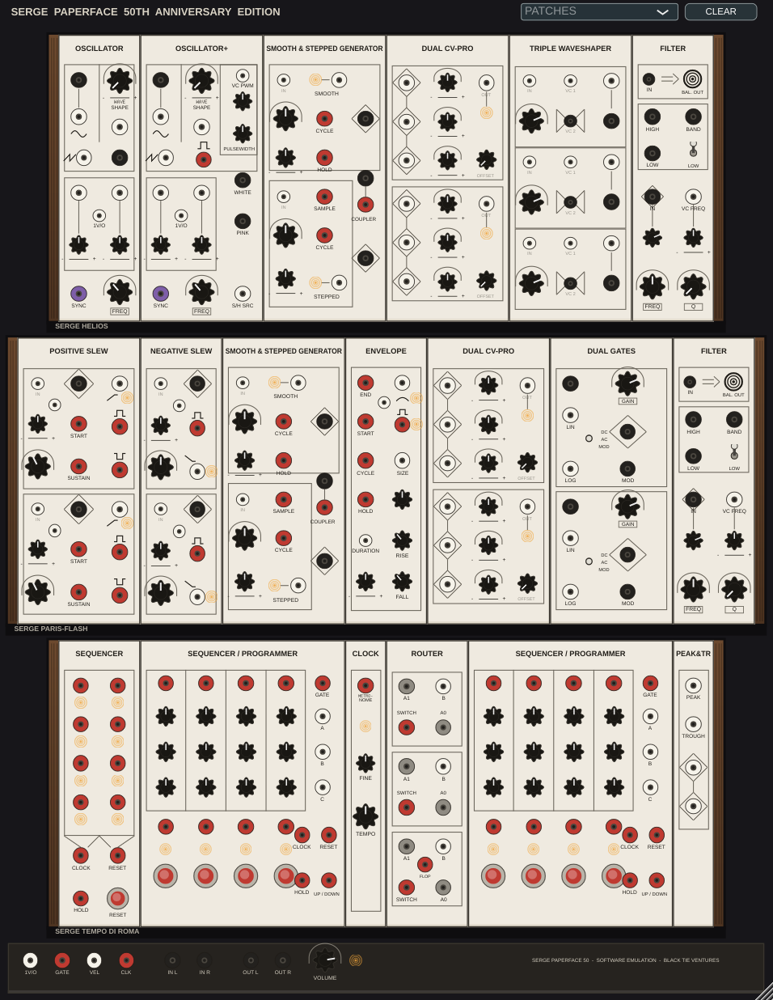

# Paperface 50 Emulation

An unofficial, non-commercial software emulation of the **Serge Paperface 50th
Anniversary Edition** modular synthesizer system — all three panels (HELIOS
voice, PARIS-FLASH slopes, TEMPO DI ROMA sequencing) — as fully
banana-patchable AU/VST3 plugins for macOS, written in C++/JUCE.



Everything is patchable exactly as on the hardware: drag banana cables between
any jacks, stack outputs, build feedback patches. Nothing sounds until you
patch it. Behavior follows the official *Paperface 50 user manual* v0.1
(Random\*Source, Dec 2023); the panel UI is a from-scratch programmatic
redrawing in the style of that manual's panel drawings — no scanned or
copied assets.

| Plugin | Type | Formats |
|---|---|---|
| **Paperface 50** | Instrument (`aumu Pf50 Bktv`) | AU · VST3 · Standalone |
| **Paperface 50 FX** | Music effect (`aumf Pf5F Bktv`) | AU · VST3 · Standalone |

## Status

**v1.0.0** — feature-complete first release. All hard gates green on macOS
arm64: 73/73 headless DSP verification tests (1V/oct tracking ≤3 cents,
12 dB/oct filter slopes, ring-mod carrier suppression, feedback-stress
NaN-free, bit-exact state round-trip, ~55× realtime single-core on M2 Max),
`auval` PASS for both Audio Units. The v2 program — component-level circuit
modeling with tiered accuracy (static curves → semi-physical → full DK/WDF →
neural hero blocks) and a computed CPU budget for M-series chips — is in
[`docs/PF50_V2_PLAN.md`](docs/PF50_V2_PLAN.md) with an editable cost model in
[`docs/PF50_v2_cost_model.xlsx`](docs/PF50_v2_cost_model.xlsx).

## How this was built

The project was built end-to-end by Claude (Anthropic) as the demonstration
run of a **Gauntlet Loop** — Matt Shumer's builder/critic iteration technique
— in its *Verifiable Gauntlet* variant: hard gates (compile, the 73-assertion
DSP suite, `auval`, install) were written and frozen **before** any
implementation code, and the panel UI had to survive blind comparison by
fresh critic agents against the manual's drawings until a critic preferred
it. The frozen gauntlet and the complete round log (including the two failed
rounds and what they caught) are preserved in [`gauntlet/`](gauntlet/) —
read `LOG.md` for the honest history. Technique credit: Matt Shumer
([Claude-of-Duty](https://github.com/mshumer/Claude-of-Duty)); variants drawn
from [robonuggets/gauntlet-loop](https://github.com/robonuggets/gauntlet-loop)
(CC BY 4.0) and [martbln/benchmark-loop](https://github.com/martbln/benchmark-loop).

## Building

Requirements: macOS (arm64 tested; Linux builds VST3/Standalone), CMake ≥3.22,
Xcode command-line tools, and JUCE 8 — a checkout at `~/JUCE` is used if
present, otherwise CMake fetches JUCE 8.0.6.

```bash
cmake -B build -DCMAKE_BUILD_TYPE=Release
cmake --build build -j
./build/pf50_gauntlet          # run the 73-assertion DSP verification suite
auval -v aumu Pf50 Bktv        # after copying the AU into ~/Library/Audio/Plug-Ins/Components
```

Built plugins land in `build/*_artefacts/Release/{AU,VST3,Standalone}`; copy
the `.component` and `.vst3` bundles into `~/Library/Audio/Plug-Ins/`.

## Quick start in a DAW

Load **Paperface 50** in an instrument slot, open **PATCHES** (top right),
choose *First Voice*, play MIDI. Audio reaches the DAW only through the I/O
strip's **OUT L/R** jacks or a FILTER's **BAL. OUT** tap — like the hardware,
silence means "patch something." Right-click a jack to remove cables. Knobs:
drag, ⇧ fine, double-click reset. The whole patch (cables + knobs) saves with
the host project. Module-by-module reference: [`docs/PANEL_SPEC.md`](docs/PANEL_SPEC.md);
deliberate engineering interpretations of under-documented panel details are
logged in `gauntlet/LOG.md`.

## Legal

This is a fan-made, unofficial emulation for personal, non-commercial use,
built from the publicly available user manual. It is **not affiliated with,
endorsed by, or connected to** Serge Modular, Random\*Source, or Serge
Tcherepnin. *Serge* and related marks are the property of their owners; they
are used here only to describe what this software emulates.

- **Code license:** [GNU AGPL-3.0](LICENSE). The project uses the
  [JUCE framework](https://github.com/juce-framework/JUCE) under its AGPLv3
  open-source option (JUCE's bundled VST3 SDK fork is MIT-licensed). JUCE is
  not vendored in this repository; it is fetched at configure time.
- **No manufacturer assets are included or redistributed**: no manual PDF, no
  panel scans, no photographs, no firmware, no schematics. The UI is drawn
  programmatically; `docs/PANEL_SPEC.md` is a factual functional summary with
  brief cited quotations.
- The circuits' *behavior* is emulated from public documentation and
  published analyses (e.g., Gormond, Esqueda, Pöntynen & Parker's DAFx-18
  Triple Waveshaper study; Stinchcombe's VCS analysis) — functional behavior
  of 1970s circuits is not subject to copyright, and the Serge lineage has a
  long, deliberate DIY/open heritage (CGS et al.).
- If you are a rights holder and object to anything here, open an issue and
  it will be addressed promptly, including takedown if asked.

Buy the hardware if you can — nothing here replaces banana cables you can
actually touch.

## Credits

Design lineage: Serge Tcherepnin (1972–73) and Random\*Source (50th
Anniversary redesigns). Emulation: built by Claude (Anthropic) for
Mark Renker / Black Tie Ventures, August 2026. Gauntlet Loop technique:
Matt Shumer.
